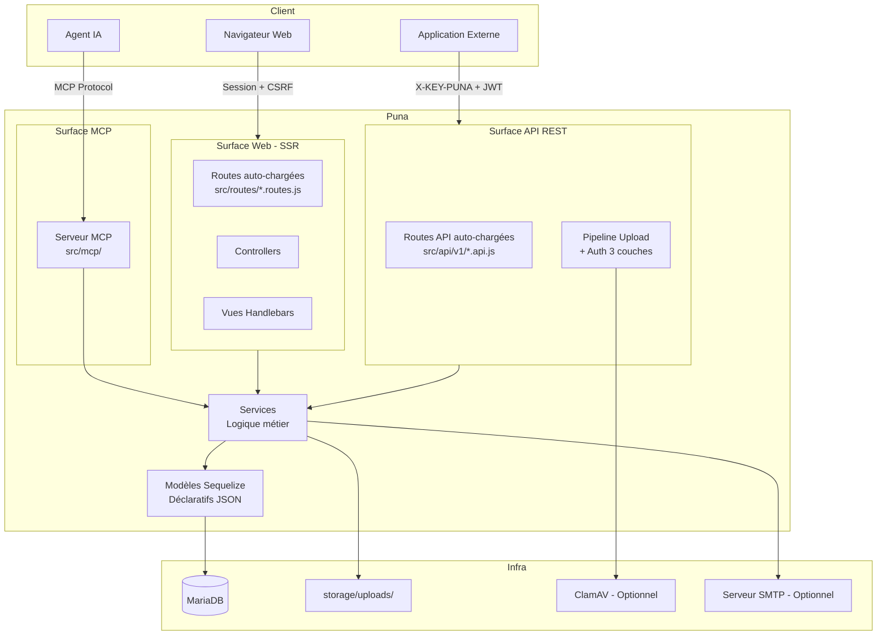

# Contribuer à Puna

Merci de l'intérêt que vous portez à Puna ! Ce guide explique comment contribuer au projet, que ce soit pour signaler un bug, proposer une fonctionnalité ou soumettre du code.

Avant tout, veuillez lire notre [Code de Conduite](CODE_OF_CONDUCT.md). Toute participation implique d'en respecter les termes.

---

## Table des matières

- [Par où commencer ?](#par-où-commencer-)
- [Prérequis](#prérequis)
- [Installation pour le développement](#installation-pour-le-développement)
- [Architecture du projet](#architecture-du-projet)
- [Conventions de code](#conventions-de-code)
- [Workflow Git](#workflow-git)
- [Signaler un bug](#signaler-un-bug)
- [Proposer une fonctionnalité](#proposer-une-fonctionnalité)
- [Soumettre une Pull Request](#soumettre-une-pull-request)
- [Tests](#tests)
- [Scripts utilitaires](#scripts-utilitaires)
- [Licence](#licence)

---

## Par où commencer ?

Le projet est encore jeune et les issues taguées `good first issue` n'existent pas encore, elles apparaîtront naturellement au fil du temps.

En attendant, voici ce que vous pouvez faire dès maintenant :

- **Tester l'installation** sur votre environnement (natif ou Docker) et signaler tout ce qui coince
- **Lire la documentation** et ouvrir une issue si quelque chose est peu clair ou manquant
- **Signaler un bug** via le template d'issue prévu à cet effet
- **Lire le code** et poser des questions - une bonne question peut devenir une amélioration de doc

Si vous souhaitez contribuer du code sans savoir par où commencer, ouvrez une issue pour en discuter avant de vous lancer. C'est le meilleur moyen d'éviter un travail qui ne pourrait pas être mergé.

---

## Prérequis

- **Node.js** 24+
- **MariaDB** 11+
- **npm** 10+
- **Git**

---

## Installation pour le développement

```bash
# 1. Forker le dépôt sur GitHub, puis cloner votre fork
git clone https://github.com/<votre-pseudo>/Puna.git
cd Puna

# 2. Générer le fichier .env (script interactif, aucune dépendance requise)
npm run setup

# 3. Installer les dépendances
npm install

# 4. Lancer le serveur en mode développement (rechargement automatique)
npm run dev
```

Le serveur démarre sur `http://localhost:3022` (ou le port configuré dans votre `.env`).

### Avec Docker

```bash
npm run setup # Sélectionner le mode Docker quand demandé
docker compose up -d
```

---

## Architecture du projet

Puna est une application Node.js (ESM) avec Express 5, Sequelize (MariaDB) et des vues Handlebars.

### Vue d'ensemble



### Middleware Stack (ordre strict)

```
helmet → cors(/api) → session → passport → flash → injectUserRole → csrfProtection → sanitize
```

### Trois surfaces distinctes

| Surface    | Préfixe     | Auth                      |
| ---------- | ----------- | ------------------------- |
| Web (SSR)  | `/`         | Session + Passport        |
| API public | `/api/v1/…` | `X-KEY-PUNA` + Bearer JWT |
| Server MCP | `/mcp/…`    | Bearer JWT                |

### Conventions d'auto-chargement

- **Routes web** : chaque fichier `src/routes/*.routes.js` est monté automatiquement.
- **Routes API** : chaque fichier `src/api/v1/*.api.js` est monté sous `/api/v1/<nom>`.
- **Modèles** : chaque `src/models/*.models.js` est chargé par `src/models/index.js`.

### Pattern Controller → Service

- **Controllers** (`src/controllers/`) : gèrent le HTTP - lisent `req`, appellent les services, redirigent ou rendent les vues.
- **Services** (`src/services/`) : contiennent toute la logique métier et les requêtes Sequelize. Ils retournent du JSON (`model.toJSON()`), jamais des instances Sequelize brutes.

### Modèles déclaratifs

Les modèles sont définis via des fichiers JSON, pas du code Sequelize manuel :

```
src/models/attributes/form.attributes.json   ← définition des colonnes
src/models/relations/form.relations.json     ← associations
src/models/form.models.js                    ← appelle le builder
```

Ne jamais écrire `DataTypes.STRING` directement dans un fichier de modèle.

---

## Conventions de code

### Général

- **ESM uniquement** (`import`/`export`) - pas de `require()` ni de CommonJS
- **Pas de `dotenv`** - les variables d'environnement sont chargées via `node --env-file=.env`
- Les fichiers sont servis directement, **sans étape de build**

### Formatage et lint

```bash
npm run lint:fix    # ESLint 9 flat config - corrige automatiquement
npm run format      # Prettier (JS/JSON) + formateur HBS personnalisé
```

Le projet utilise ESLint 9 avec une configuration `eslint.config.js` (flat config). Les règles sont déjà configurées - ne pas les modifier sans discussion préalable.

### Internationalisation

Tous les messages visibles par l'utilisateur doivent utiliser le système i18n :

- Dans les controllers/middlewares : `req.__('clé')` ou `res.__('clé')`
- Dans les vues HBS : `{{__ "clé"}}`
- Les clés sont définies dans `src/locales/fr.json`

Ne pas ajouter de chaînes françaises directement dans le code.

### Sécurité

- Les clés cryptographiques viennent exclusivement des variables d'environnement
- Les accès aux données sont scopés via `getSiteWhereCondition()` depuis `src/services/access.service.js` - ne jamais hardcoder des conditions WHERE pour le contrôle d'accès
- Les permissions sont définies dans `src/config/permissions.js`

---

## Workflow Git

### Branches

```
main        → branche stable, protégée (merge via PR uniquement)
develop     → branche de travail quotidien
feature/*   → nouvelles fonctionnalités (créées depuis develop)
fix/*       → corrections de bugs (créées depuis develop)
docs/*      → documentation (créée depuis develop)
release/*   → préparation d'une release (merge dans main + tag)
```

### Processus standard

```bash
# 1. Se placer sur develop et mettre à jour
git checkout develop
git pull origin develop

# 2. Créer une branche
git checkout -b feature/ma-fonctionnalite

# 3. Développer, commiter (voir conventions ci-dessous)
git add .
git commit -m "feat(scope): description courte"

# 4. Pousser et ouvrir une PR vers develop
git push origin feature/ma-fonctionnalite
```

### Conventions de commits - Conventional Commits

Format : `<type>(<scope>): <description>`

| Type       | Usage                                   |
| ---------- | --------------------------------------- |
| `feat`     | Nouvelle fonctionnalité                 |
| `fix`      | Correction de bug                       |
| `docs`     | Documentation uniquement                |
| `test`     | Ajout ou modification de tests          |
| `chore`    | Maintenance (dépendances, CI, config)   |
| `refactor` | Refactoring sans changement fonctionnel |
| `style`    | Formatage, espaces, points-virgules     |

**Exemples :**

```
feat(auth): ajouter la validation du mot de passe fort
fix(site): corriger la vérification d'unicité du domaine
docs: mettre à jour le guide d'installation
test(service): ajouter les tests unitaires pour twoFactor
chore(deps): mettre à jour express vers 5.1.0
```

Règles :

- Description en **minuscules**, sans point final
- Temps **présent à l'infinitif** : "ajouter", "corriger", "mettre à jour"
- Longueur max de la ligne de sujet : **72 caractères**

---

## Signaler un bug

Utiliser le **template d'issue "Bug report"** sur GitHub. Remplir tous les champs obligatoires :

- Description claire et concise du problème
- Étapes de reproduction précises
- Comportement attendu vs comportement observé
- Mode d'installation (Docker ou natif), version de Node.js, OS
- Logs ou messages d'erreur le cas échéant

> ⚠️ **Ne jamais signaler de faille de sécurité via une issue publique.** Consulter [SECURITY.md](SECURITY.md) pour la procédure de divulgation responsable.

---

## Proposer une fonctionnalité

Utiliser le **template d'issue "Demande de fonctionnalité"** sur GitHub. Décrire :

1. Le problème ou le besoin concret que la feature résoudrait
2. La solution envisagée
3. Les alternatives considérées et pourquoi elles ont été écartées

Les demandes sans contexte ou sans justification claire seront fermées.

---

## Soumettre une Pull Request

### Avant d'ouvrir la PR

Une CI automatique (lint + tests) se déclenche à l'ouverture de toute PR vers `develop` ou `main`.<br>
Pour éviter des allers-retours inutiles, vérifiez en local au préalable :

```bash
npm run lint
npm run format:check
npm run test
```

- [ ] La branche part de `develop` et la PR cible `develop` (jamais `main` directement)
- [ ] `npm run lint` ne remonte aucune erreur
- [ ] `npm run format:check` ne remonte aucune erreur
- [ ] `npm run test` passe sans erreur
- [ ] Les nouveaux messages utilisent i18n (pas de chaînes françaises en dur)
- [ ] Des tests sont ajoutés pour toute nouvelle fonctionnalité ou correction

### Lors de l'ouverture

- Utiliser le **template de PR** pré-rempli
- Lier l'issue correspondante avec `Closes #<numéro>`
- Décrire clairement les changements apportés
- Ajouter des captures d'écran pour les changements visuels

### Review

Les PRs nécessitent au moins une validation avant d'être mergées. La CI (lint + tests) doit être verte.

En tant que mainteneur solo, je m'efforce de répondre aux PRs dans un délai de **7 jours** et de traiter les demandes de modification sous **30 jours**. Ces délais sont donnés à titre indicatif et peuvent être dépassés selon les disponibilités.
Les PRs sans réponse au-delà de 30 jours seront fermées mais pourront être rouvertes sur demande.

---

## Tests

### Lancer les tests

```bash
npm test              # Exécution unique (Vitest)
npm run test:watch    # Mode interactif
npm run test:coverage # Avec rapport de couverture
```

### Structure

```
tests/
├── unit/           # Tests unitaires (utils, services, helpers)
├── integration/    # Tests d'intégration (routes, pipeline API)
├── middlewares/    # Tests des middlewares
└── e2e/            # Tests end-to-end (Playwright)
```

### Conventions

- Framework : **Vitest** avec `globals: true`
- Toujours mocker ces trois modules dans les tests unitaires :

```js
vi.mock('../../../src/config/logger.js', () => ({
    logger: { info: vi.fn(), warn: vi.fn(), error: vi.fn() },
}));
vi.mock('../../../src/models/index.js', () => ({
    default: { MonModele: { findByPk: vi.fn() } },
}));
vi.mock('../../../src/utils/crypto.js', () => ({
    encryptString: vi.fn((s) => `enc:${s}`),
    decryptString: vi.fn((s) => s.replace('enc:', '')),
}));
```

- Fichier de référence : `tests/unit/services/twoFactor.service.test.js`
- Les tests ne doivent pas dépendre d'une base de données réelle (utiliser des mocks Sequelize)

---

## Scripts utilitaires

### Développement

| Commande          | Description                                         |
| ----------------- | --------------------------------------------------- |
| `npm run dev`     | Démarrage avec rechargement automatique (`--watch`) |
| `npm start`       | Démarrage en production                             |
| `npm run setup`   | Génération interactive du fichier `.env`            |
| `npm run prepare` | Installation des hooks Husky (git hooks)            |

### Qualité de code

| Commande               | Description                         |
| ---------------------- | ----------------------------------- |
| `npm run lint`         | Vérification ESLint                 |
| `npm run lint:fix`     | Correction automatique ESLint       |
| `npm run format`       | Formatage Prettier (JS, JSON) + HBS |
| `npm run format:hbs`   | Formatage HBS uniquement            |
| `npm run format:check` | Vérification du formatage (CI)      |

### Logs

| Commande              | Description                      |
| --------------------- | -------------------------------- |
| `npm run logs:rotate` | Rotation manuelle des logs       |
| `npm run logs:clean`  | Nettoyage des archives de logs   |
| `npm run logs:stats`  | Statistiques et analyse des logs |

### Données

| Commande                       | Description                                   |
| ------------------------------ | --------------------------------------------- |
| `npm run test:e2e:seed`        | Seed de la base de test (Playwright)          |
| `npm run test:coverage:badges` | Couverture + mise à jour des badges du README |

---

## Licence

En contribuant à ce projet, vous acceptez que vos contributions soient publiées sous les termes de la licence **GNU Affero General Public License v3.0 (AGPLv3)** qui régit ce projet.
